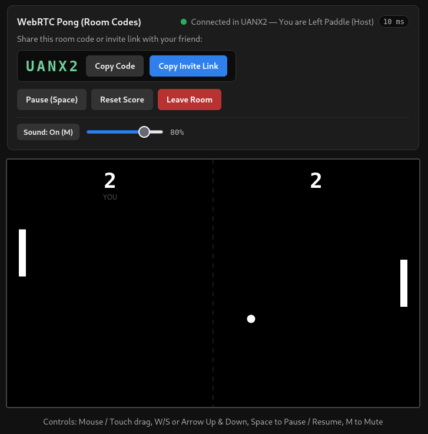

# WebRTC Pong

A lightweight, serverless peer-to-peer Pong game built with Svelte 5, WebRTC, and [Trystero](https://github.com/dmotz/trystero). Create a room, share the room code or invite link with a friend, and play directly in the browser.



## Features

- **Serverless P2P Multiplayer:** Uses WebRTC data channels via Trystero—no dedicated game server required.
- **Room Codes & Invite Links:** Host a match with an auto-generated room code (e.g., `UANX2`) and share it with one-click **Copy Code** or **Invite Link** buttons.
- **Live Latency Display:** Shows real-time connection ping (`ms`) and host/paddle assignment.
- **Game & Audio Controls:** Built-in pause/resume, score reset, sound toggle, custom win sounds, and volume slider.
- **Cryptographic Identity & Web of Trust:** Dual-signed match receipts and peer-to-peer friend vouching.
- **Cross-Device Input:** Play with mouse, touch drag, or keyboard.

## Controls

| Action | Input |
| --- | --- |
| Move Paddle | `Mouse` / `Touch drag` / `W` & `S` / `Arrow Up` & `Arrow Down` |
| Pause / Resume / Ready | `Space` |
| Mute / Unmute | `M` |

## Getting Started

### Prerequisites

- [Node.js](https://nodejs.org/) (v18+ recommended)

### Development & Build

1. Clone the repository:
   ```bash
   git clone https://github.com/ar00n/webrtc-pong.git
   cd webrtc-pong
   ```

2. Install dependencies:
   ```bash
   npm install
   ```

3. Run local dev server:
   ```bash
   npm run dev
   ```

4. Build static GitHub Pages output to `docs/`:
   ```bash
   npm run build
   ```

## Tech Stack

- **[Svelte 5](https://svelte.dev/)** — Reactive UI components & runes
- **[Vite](https://vite.dev/)** — Dev server and static bundler targeting `docs/`
- **[Trystero](https://github.com/dmotz/trystero)** — Serverless WebRTC matchmaking and peer communication

## License

This project is licensed under the [ISC License](LICENSE).
